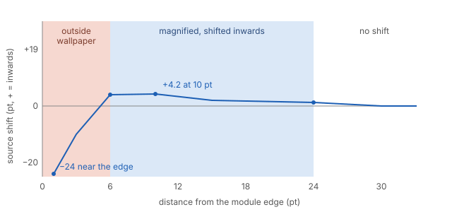

# Glass materials

How the translucent surfaces of the reference desktop transform what lies behind them. These
are measurements of behaviour: since UI 1.0.0 the compositor draws the Amalfi materials instead
([`../design/amalfi/materials.md`](../design/amalfi/materials.md), [`../m2-glass.md`](../m2-glass.md)),
and only the sharp share of the blur model below is kept on top of them. Measured over
generated test wallpapers:

- solid grey `#7a7b80`, black and white;
- black and white stripes of 48, 12 and 6 pt;
- colour bands;
- ramps and sawtooth ramps of grey, red, green and blue;
- maps where the level encodes the coordinate, used to trace refraction.

## Models

Two models describe every material. Both work on **encoded sRGB values (0–255)**, not on
linear light: fitting in linear light was about ten times worse.

**Blur.** Each output channel is

```
out = a · (w · in + (1 − w) · G_σ(in)) + b
```

- `G_σ` is a Gaussian blur of standard deviation σ, in pt.
- `w` is the share of the image that stays sharp.

**Colour.** The general fit is a 3 × 3 matrix plus an offset, `out = M · in + b`. A
simpler constrained form is

```
out = g · ((1 − s) · L + s · I) · in + c
```

- `L` is the Rec. 709 luminance matrix, so every row of `L` is (0.2126, 0.7152, 0.0722).
- `s` is the saturation: values above 1 make colours more vivid.
- `g` is a gain and `c` an offset.

A material is implemented as blur first, then the colour transform. The colour transform is
affine, so it commutes with the blur and the order does not matter.

## Dock background (glass.md › Dock)

### Blur

| Appearance | Stripes | σ (pt) | w | rmse |
|---|---|---|---|---|
| Light | vertical | 2.5 | 0.28 | 3.4 |
| Light | horizontal | 3.0 | 0.26 | 2.4 |
| Dark | vertical | 2.5 | 0.28 | 4.6 |
| Dark | horizontal | 3.25 | 0.28 | 3.6 |

- The blur is small and almost the same in x and y.
- **The real profile has two parts:** a sharp step about 3 pt wide, with soft tails of
  about 9 pt on each side. The two-part model reproduces it within the errors above. The
  exact kernel is unknown.

### Colour

Full matrix:

| Appearance | M (rows: output R, G, B) | b | rmse |
|---|---|---|---|
| Light | `[[1.100, -0.314, -0.033], [-0.146, 0.805, 0.087], [-0.158, -0.328, 1.242]]` | `[37.3, 39.3, 36.8]` | 2.45 |
| Dark | `[[1.058, -0.307, -0.083], [-0.199, 0.729, 0.141], [-0.164, -0.327, 1.159]]` | `[16.2, 15.7, 16.3]` | 4.71 |

Constrained form:

| Appearance | s | g | c | rmse |
|---|---|---|---|---|
| Light | 1.65 | 0.748 | 37.8 | 5.25 |
| Dark | 1.79 | 0.660 | 17.7 | 7.93 |

- **Gain on grey:** each row of M sums to about 0.75 in light and 0.67 in dark.
- **Black and white seen through the glass:**

  | Appearance | Black | White |
  |---|---|---|
  | Light | about `#262626` | about `#e0e0e0` |
  | Dark | about `#121212` | about `#adadad` |

  On the stripes, black reads 39 and white 228 in light; black reads 15 and white 177 in
  dark.
- **Over the grey `#7a7b80`** the fill is `#818289` in light and `#68696e` in dark.
- **Saturation goes up:** behind the glass a red ramp reaches R 255 at an input of about
  220, while G and B drop from 38 to 13.

Transfer on grey, written as input → output in hex:

| Input | 4 | 20 | 36 | 52 | 68 | 84 | 100 | 116 | 132 | 148 | 164 | 180 | 196 | 212 | 228 | 244 | 252 |
|---|---|---|---|---|---|---|---|---|---|---|---|---|---|---|---|---|---|
| Light | 2b | 35 | 41 | 4d | 59 | 65 | 71 | 7d | 89 | 95 | a1 | ad | b9 | c5 | d1 | dd | e0 |
| Dark | 12 | 1d | 2a | 36 | 42 | 4e | 59 | 64 | 6e | 78 | 82 | 8b | 93 | 9b | a3 | aa | ad |

The dark curve is not a straight line. Its slope is about 0.74 at low levels and 0.46 at
high levels, so bright backgrounds are compressed more.

### Edge highlight

- **Top and bottom edges:** a 1 pt row brighter than the fill, followed by a gradient about
  7 pt deep towards the inside.
- **More lift on dark backgrounds:** over black the last row reaches 98, while the gradient
  runs 38 → 51. Over white the rows read 236 → 229. The lift is about +13 on dark
  backgrounds and +7 on light ones, so it is not a constant amount.

### Refraction

Measured with 6 pt stripes, by comparing where the stripes cross mid-grey inside and outside
the glass.

| Edge | Zone affected | Largest shift | Direction |
|---|---|---|---|
| Left | 16–24 pt from the edge | about 5 pt, 6 pt in | each pixel shows wallpaper from further inside |
| Right | 12–22 pt | about 4 pt, 12 pt in | same |
| Top | up to 12 pt | ≤ 1 pt (noise) | — |
| Bottom | about 5 pt | about 3 pt | inwards |

- **The side edges magnify like a lens:** the first stripe inside the left edge looks about
  10 pt wide instead of 6.
- **Noise:** shifts below 1 pt cannot be told apart from noise. Within 5 pt of the edge the
  highlight gradient disturbs the method.

## Control Center modules (glass.md › Control Center)

In macOS 27 the Control Center has no panel behind it. Every module is its own glass tile.

### Blur and colour

- **Blur:** σ = 4.5 pt with w = 0.04 (rmse 0.73), so it is almost a pure Gaussian. It is
  identical in light and dark. Black reads 32 and white 186.

Colour, fitted on 58 517 glass-only pixels from 11 modules:

| Appearance | M | b | rmse | Constrained |
|---|---|---|---|---|
| Light | `[[0.946, -0.285, -0.037], [-0.126, 0.651, 0.094], [-0.140, -0.297, 1.064]]` | `[30.6, 32.0, 30.3]` | 3.33 | s 1.74, g 0.613, c 32.3 |
| Dark | `[[0.942, -0.289, -0.041], [-0.130, 0.646, 0.090], [-0.144, -0.304, 1.061]]` | `[31.2, 32.5, 30.8]` | 1.82 | s 1.77, g 0.602, c 32.6 |

- **Same material in both appearances:** unlike the Dock, the module material barely
  changes between light and dark. Over the grey it gives `#6a6b70` in both.
- **Transfer on grey (dark), input → output in hex:**

  | Input | 12 | 24 | 36 | 48 | 60 | 72 | 84 | 96 | 108 | 119 | 131 | 143 | 155 | 167 | 179 | 191 | 203 | 215 | 227 | 239 |
  |---|---|---|---|---|---|---|---|---|---|---|---|---|---|---|---|---|---|---|---|---|
  | Output | 27 | 2f | 36 | 3d | 44 | 4c | 53 | 5a | 61 | 69 | 70 | 77 | 7e | 84 | 8d | 94 | 9b | a2 | aa | b1 |

### Lens refraction

The bending at the edges is much stronger than in the Dock and has two bands.

| Distance from the edge | What the glass shows |
|---|---|
| 0–6 pt | wallpaper from **outside** the module, up to about 25 pt beyond the edge, squeezed into a few pt |
| 6–24 pt | wallpaper shifted inwards, magnified by up to about 4 pt |
| beyond 24–30 pt | no shift (±1 pt) |

Measured shifts, source position minus pixel position, in pt:

| Edge | 24 pt in | 9–11 pt in | ≤ 6 pt in |
|---|---|---|---|
| Left | +1.2 | +4.2 | −4 … −24 |
| Right | −2.2 | −3.8 | +4 … +15 |
| Top | +2.3 (at 19 pt) | +3.6 (at 6 pt) | −5 … −27 (within 2 pt) |

The outer band is uncertain by about ±3 pt, because the stripe crossings there are few and
close together.



## Menu bar gradient (glass.md › Menu bar)

The menu bar has **no material**. Text and icons sit directly on the wallpaper, in both
appearances. A gradient over the top of the screen darkens the highlights, so white text
stays readable on a bright wallpaper.

Output level by distance from the top of the screen (rows, in pt) and wallpaper grey level
(columns):

| y \ level | 0 | 16 | 32 | 48 | 64 | 80 | 96 | 112 | 128 | 144 | 160 | 176 | 192 | 208 | 224 | 240 |
|---|---|---|---|---|---|---|---|---|---|---|---|---|---|---|---|---|
| 0 | 1 | 16 | 32 | 48 | 64 | 80 | 96 | 110 | 112 | 116 | 121 | 127 | 135 | 144 | 154 | 165 |
| 30 | 0 | 16 | 32 | 48 | 64 | 80 | 96 | 110 | 113 | 118 | 124 | 131 | 140 | 149 | 160 | 171 |
| 45 | 0 | 16 | 32 | 48 | 64 | 80 | 96 | 111 | 116 | 123 | 130 | 139 | 148 | 159 | 171 | 183 |
| 60 | — | — | — | 48 | 64 | 80 | 96 | 111 | 119 | 128 | 138 | 148 | 160 | 172 | 185 | 198 |
| 80 | — | — | — | 48 | 64 | 80 | 96 | 111 | 124 | 136 | 149 | 163 | 177 | 191 | 205 | 220 |
| 100 | — | — | — | 48 | 64 | 80 | 96 | 112 | 127 | 142 | 157 | 172 | 188 | 203 | 219 | 235 |
| 120 | — | — | — | 48 | 64 | 80 | 96 | 112 | 128 | 144 | 160 | 176 | 192 | 208 | 224 | 240 |

A "—" means the cell was covered and not measured.

- **Which levels change:** levels below about 108 pass unchanged; higher levels are pulled
  down. At the very top, 240 becomes 165 and white becomes 176.
- **How it fades:** the effect holds for about 14 pt, then fades smoothly and is gone by
  y ≈ 115–120.
- **Light and dark:** identical in both appearances.
- **On colours:** it acts on luminance. Cyan darkens strongly, yellow drops to about
  (180, 180, 1), and a bright magenta barely changes.

## All materials compared

σ is the equivalent Gaussian blur. "Over grey" is the fill on `#7a7b80`.

| Surface | σ (pt) | Sharp w | Gain on grey | Saturation s | Over grey, light / dark | Changes with appearance | Spec |
|---|---|---|---|---|---|---|---|
| App switcher | — | — | — | — | `#818289` / `#68696e` (as the Dock) | yes | — |
| Dock background | 2.5–3.25 | 0.26–0.28 | 0.75 / 0.67 | 1.65 / 1.79 | `#818289` / `#68696e` | yes | [dock.md](dock.md) |
| Control Center modules | 4.5 | 0.04 | 0.62 / 0.61 | 1.74 / 1.77 | `#6a6b70` / `#6a6b70` | no | [controlcenter.md](controlcenter.md) |
| Volume HUD | — | — | — | — | `#6f7076` / same | no | [hud.md](hud.md) |
| Menus (menu bar, context) | about 9 (±1) | — | S-shaped curve | high, higher in dark | `#c7c8cd` / `#6f7075` | yes | [menubar.md](menubar.md) |
| Launcher | 8–9 (non-Gaussian) | ≤ 0.04 | concave curve, equal to Faro | as Faro | `#c8c9ce` / `#717276` | yes | — |
| Faro | 8–14 (non-Gaussian) | ≤ 0.12 | concave curve | about 1.7 / 1.8 | `#c8c9ce` / `#717276` | yes | — |
| Banners and notifications | 10–11 | 0.02–0.04 | 0.27–0.41 | 1.7–2.5 | `#c0c1c6` / `#75767b` | yes | [notifications.md](notifications.md) |
| Window sidebar and toolbar | opaque towards the desktop | — | — | — | — | — | [windows.md](windows.md) |
| Menu bar | no material, only the gradient above | — | — | — | — | no | above |

What all the materials share:

- **Saturation and contrast:** every measured glass raises saturation and compresses
  contrast around a middle grey.
- **Two families:**
  - **Thin glass** (Dock, Control Center modules, HUD): small blur, and the fill stays close
    to the grey behind it.
  - **Thick glass** (menus, Faro, Launcher, notifications): a blur of 8–14 pt. It looks
    almost white in light and dark grey in dark.

  Only the thick family and the Dock change with the appearance.
- **Edges:** a 1 pt bright row at the top and bottom with a gradient of about 6–7 pt
  inwards, and a 1 pt darker row at the sides.
- **Refraction:**
  - Dock: up to 5 pt over a band of about 20 pt.
  - Control Center modules: the two bands described above.
  - Thick materials: the blur hides it; menus show at most 1–2 pt at the sides.

## Not measured yet

- The Dock label over the test wallpapers.
- Module refraction with a calibrated map and over more modules.
- Refraction of the thick materials, measured with stripes wider than their blur.
- How refraction depends on the radius and size of the panel.
